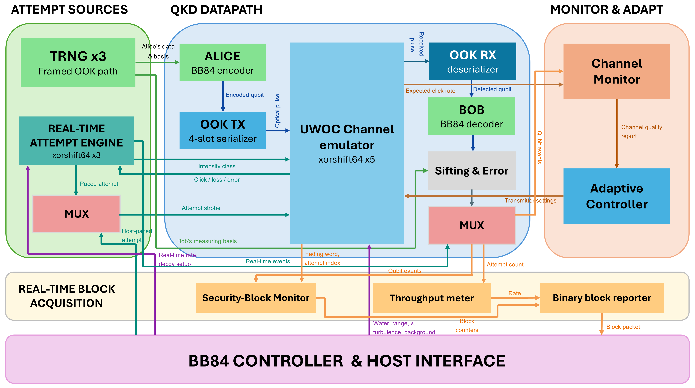
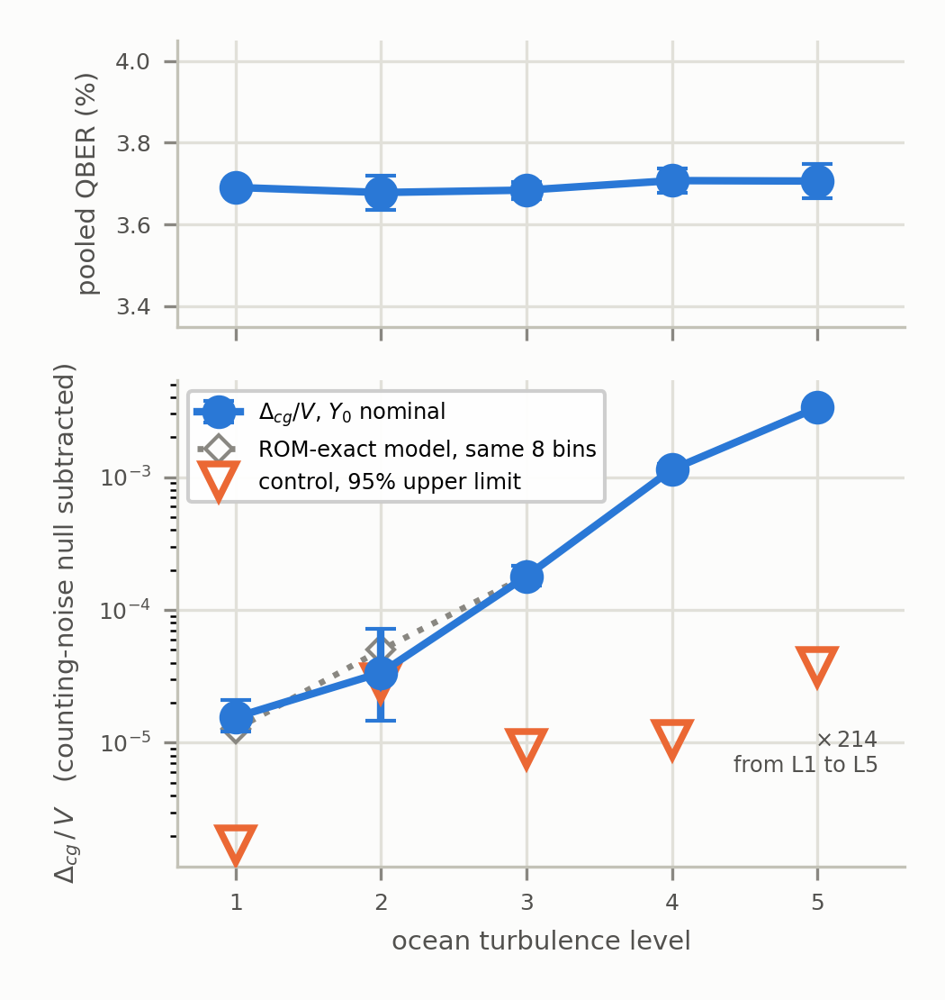
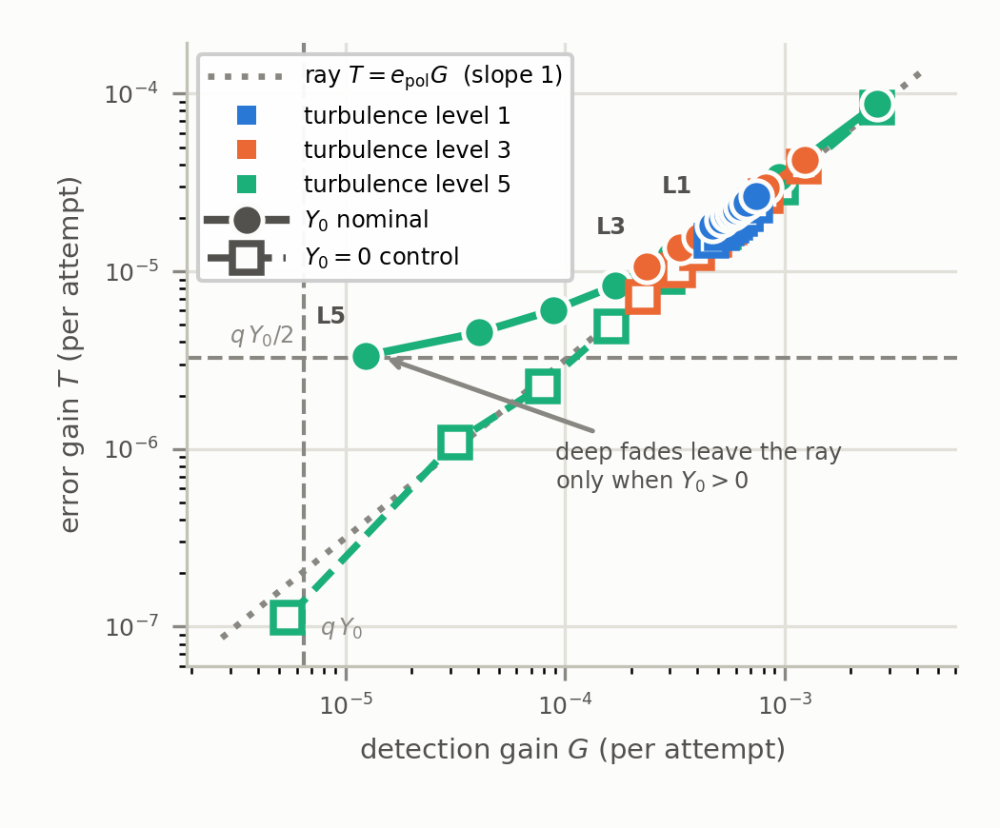
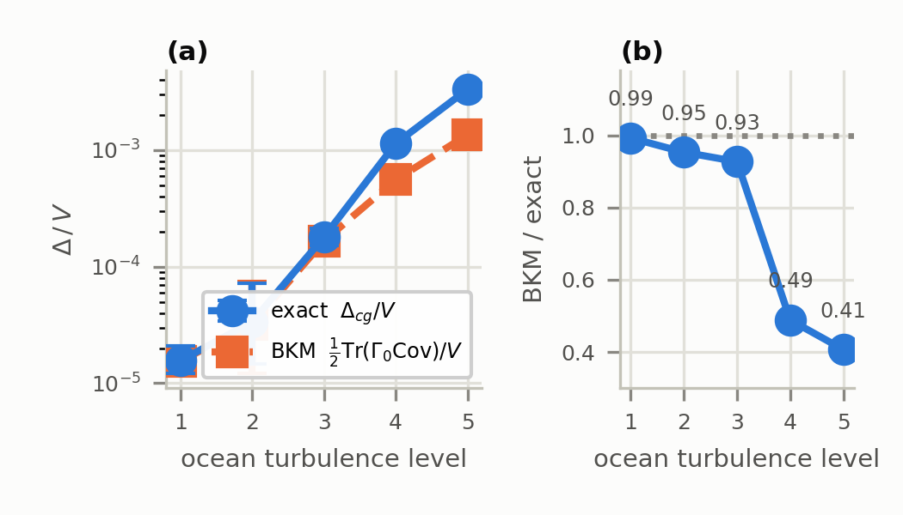
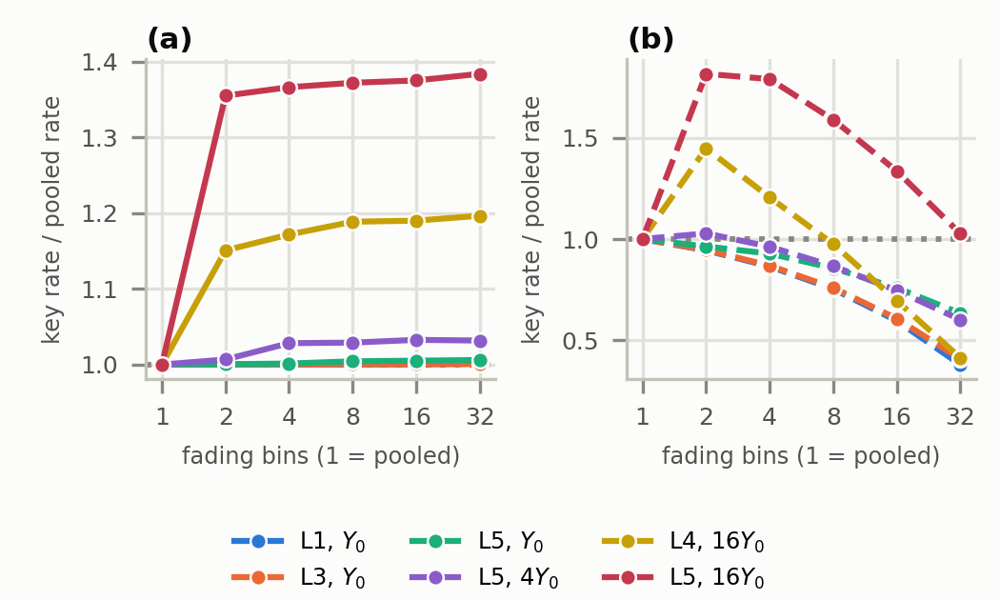

# Block-Resolved Security Analysis of BB84 QKD Using a Real-Time FPGA Emulator of Turbulent Underwater Optical Channels

<div align="center">

Real-time, block-resolved BB84 measurements on a single Cyclone II FPGA, with a synthesizable turbulent underwater optical channel emulator, controlled background and fading experiments, and an interleaved decoy-state evaluation.

[](#fpga-implementation)
[](#repository-layout)
[](#requirements)
[](#block-acquisition-path)

</div>

## Overview

Pooling all detections into a single gain and quantum bit error rate (QBER) removes the temporal label that associates detections and errors with individual fading states. This repository measures and analyzes the security-relevant structure lost by that pooling operation.

The work combines:

- a reduced BB84 coarse-graining functional expressed in affine gain and error-gain statistics;
- a 10 MHz FPGA acquisition path that records basis- and intensity-resolved counts for every `2^16`-attempt fading block;
- background-free, matched-variance, background-dose, and estimator-control experiments;
- an interleaved signal/weak-decoy/vacuum experiment comparing pooled and block-resolved decoy-state bounds.

The underlying single-FPGA BB84/UWOC platform and adaptive controller were introduced in a related RIVF 2026 manuscript. This repository is for the **block-resolved security extension**. None of the block-resolved measurements reported here comes from the earlier RIVF campaign.

> [!IMPORTANT]
> The optical channel is emulated in RTL. The measurements validate the implemented stochastic channel model, FPGA acquisition path, and analysis pipeline; they are not measurements through a physical water channel.



## Contents

- [Main results](#main-results)
- [Security quantity](#security-quantity)
- [Experimental design](#experimental-design)
- [Decoy-state experiment](#decoy-state-experiment)
- [FPGA implementation](#fpga-implementation)
- [Repository layout](#repository-layout)
- [Requirements](#requirements)
- [Reproducing the results](#reproducing-the-results)
- [Capturing new rev B data](#capturing-new-rev-b-data)
- [Validation](#validation)
- [Scope and limitations](#scope-and-limitations)
- [Citation](#citation)

## Main results

The complete rev B campaign contains **1,932,000 validated blocks**, corresponding to **1.266 × 10^11 attempts**. No recorded block failed the run-validity checks. The on-chip throughput meter reported `10^7 ± 1` attempts/s after its one-second measurement interval, and the complete acquisition required approximately **3.5 h**.

At the main operating point—clear ocean, 25 m, 450 nm, nominal `mu = 0.1`—the pooled QBER changes by only **0.029 percentage points** across turbulence levels L1–L5. The normalized coarse-graining defect increases by a factor of **214**.

| Group | Pooled QBER | Normalized defect `delta_cg` | 95% interval | `Y0 = 0` upper limit |
|---|---:|---:|---:|---:|
| L1 | 3.691% | 1.56 × 10^-5 | [1.22, 2.10] × 10^-5 | 1.71 × 10^-6 |
| L2 | 3.678% | 3.37 × 10^-5 | [1.47, 7.24] × 10^-5 | 2.80 × 10^-5 |
| L3 | 3.684% | 1.80 × 10^-4 | [1.53, 2.15] × 10^-4 | 9.00 × 10^-6 |
| L4 | 3.707% | 1.14 × 10^-3 | [1.03, 1.25] × 10^-3 | 1.05 × 10^-5 |
| L5 | 3.706% | 3.33 × 10^-3 | [3.04, 3.65] × 10^-3 | 3.72 × 10^-5 |



The measurements support four main conclusions:

1. **Pooled QBER hides fading-dependent structure.** The pooled value is nearly flat while the block-resolved defect changes by more than two orders of magnitude.
2. **Variance alone is insufficient.** Matched-variance log-normal and Weibull rows give significantly different defects because their deep-fade tails differ.
3. **The background floor creates the effect.** With `Y0 = 0`, the population statistics follow the radial line `T = e_pol G`, for which the defect is exactly zero. Restoring the background bends low-gain states away from that line.
4. **Temporal resolution can improve a valid weak-coherent bound.** In a separate decoy-state experiment, the eight-bin asymptotic rate exceeds the pooled rate by up to **37.2%** in the background-limited regime.

## Security quantity

For block `j`, let `N_j` be the number of attempts, `C_j` the number of sifted detections, and `E_j` the number of sifted errors. Define the affine statistics

```text
G_j = C_j / N_j          sifted gain
T_j = E_j / N_j          sifted error gain
e_j = T_j / G_j          block QBER, when G_j > 0
```

For the reduced symmetric single-photon BB84 model,

```text
V(G,T) = G [1 - H2(T/G)]
```

is a convex perspective function. With attempt weights `p_j = N_j / sum_k N_k`, the coarse-graining defect is

```text
Delta_cg = sum_j p_j V(G_j,T_j) - V(sum_j p_j G_j, sum_j p_j T_j) >= 0.
```

Two normalizations must not be confused:

- `delta_cg = Delta_cg / V(G_bar,T_bar)` is the dimensionless quantity plotted and tabulated in the campaign;
- `Delta_cg / G_bar` has the information-theoretic interpretation

```text
Delta_cg / G_bar = I(J;X),
```

where `J` is the fading-block label of a randomly selected sifted detection and `X` is its error bit. Therefore, the defect is zero exactly when all detected-event-weighted blocks have the same error probability.

The general relative-entropy coarse-graining inequality and its Petz-recovery interpretation are developed in the manuscript. Only the reduced two-statistic functional above is evaluated on the FPGA data.

## Why background counts matter

When `Y0 = 0`, turbulence changes the gain but not the signal error fraction:

```text
T_j = e_pol G_j.
```

All population points lie on one ray through the origin. Since `V` is positively homogeneous, radial gain fluctuations produce zero defect exactly, not only to second order.

With nonzero background counts, deep fades suppress the signal while the background floor remains fixed. Low-gain blocks bend toward a QBER of one half, making the block label informative about the error bit. At L5, the deepest bin reaches 27.0% QBER while contributing only 0.28% of all sifted detections, so it is prominent in block-resolved statistics but nearly invisible in pooled QBER.



## Experimental design

Unless otherwise stated, measurements use:

| Parameter | Value |
|---|---:|
| Water model | Clear ocean |
| Distance | 25 m |
| Wavelength | 450 nm |
| Nominal intensity | `mu = 0.1` |
| Background probability | `Y0 = 1.3 × 10^-5`, 24-bit code 218 |
| Polarization error | `e_pol = 3.178%` |
| Attempts per fading block | `2^16 = 65,536` |
| Attempt rate | 10 MHz |
| Block interval | 6.55 ms |
| Analysis partition | 8 equal-population bins |
| Null simulations | 600 |
| Block-bootstrap replicates | 600 |

### Nominal turbulence and radial-null controls

L1–L3 use unit-mean log-normal fading; L4–L5 use unit-mean Weibull fading. Every nominal group has a same-bitstream `Y0 = 0` control. Independent repeat captures are retained for the L3 and L5 background-free checks.

### Matched-variance fading-law controls

Two extra ROM rows separate distribution shape from scintillation index:

| Comparison | Log-normal | Weibull | Measured defect ratio |
|---|---|---|---:|
| Variance near L3 | L3 | `WB@L3`, row 6 | 1.72 |
| Variance near L4 | `LN@L4`, row 7 | L4 | 2.10 |

The heavier deep-fade tail of the adopted Weibull row produces a larger defect even when the second moment is approximately matched.

### Background dose response

At L3 and L5, `Y0` is swept over 24-bit codes `54, 109, 218, 436, 872, 1744, 3488`, corresponding to `Y0/4` through `16Y0`. All fourteen measurements are resolved, and the RTL population model reproduces them within measured-to-model ratios of 0.87–1.19.

### Observable label

The emulator exposes its latent 12-bit fading word, but a deployed QKD link would not. The analysis therefore also bins blocks using detections from basis-mismatched rounds, which are disjoint from the sifted rounds. With eight bins, this observable label retains 87%, 92%, and 85% of the latent-label defect at L3, L4, and L5, respectively.

### Local BKM approximation

The repository compares the exact defect with the local quadratic approximation

```text
Delta_cg approximately (kappa/2) Var[T_j - e_star G_j].
```

The quadratic-to-exact ratio is 0.99, 0.95, and 0.93 at L1–L3, then falls to 0.49 and 0.41 at L4–L5. The local approximation therefore tracks weak fluctuations but underestimates the contribution of the strong deep-fade tail.



## Decoy-state experiment

The `mu = 0.1` defect campaign is a security diagnostic, not a weak-coherent secret-key-rate measurement. At that operating point, the source multiphoton probability exceeds the total detection probability, so a tagged-source GLLP treatment certifies no key.

A separate experiment interleaves three intensity classes inside every fading block:

| Class | Mean photon number | Selection probability |
|---|---:|---:|
| Signal | `mu = 0.4` | 0.70 |
| Weak decoy | `nu = 0.05` | 0.20 |
| Vacuum | 0 | 0.10 |

Because the three classes are interleaved attempt by attempt, they experience the same fading realization. Vacuum-plus-weak-decoy bounds are evaluated separately by basis and converted to bit/s using the measured 10 MHz attempt rate.

| Point | Pooled asymptotic | 8-bin asymptotic | Ratio | Selection-adjusted finite-statistics ratio, 2 bins |
|---|---:|---:|---:|---:|
| L1, `Y0` | 4557 bit/s | 4558 bit/s | 1.000 | 0.94 |
| L3, `Y0` | 4518 bit/s | 4520 bit/s | 1.000 | 0.94 |
| L5, `Y0` | 4534 bit/s | 4554 bit/s | 1.004 | 0.96 |
| L5, `4Y0` | 4093 bit/s | 4212 bit/s | 1.029 | 1.02 |
| L4, `16Y0` | 2421 bit/s | 2877 bit/s | 1.188 | 1.42 |
| L5, `16Y0` | 2354 bit/s | 3229 bit/s | **1.372** | **1.79** |

The finite-statistics curves replace gains and error gains by conservative one-sided Clopper–Pearson limits with a total failure probability of `10^-9`. The partition-selection cost is included by dividing the failure budget among the six tested partitions.

> [!CAUTION]
> This is a statistical-fluctuation analysis of an asymptotic decoy-state bound. It is **not** a composable finite-key security proof.



## FPGA implementation

### Block-acquisition path

Four RTL modules implement the real-time measurement extension:

| Module | Function | Logic elements | Registers |
|---|---|---:|---:|
| `security_block_monitor.v` | Basis- and intensity-resolved affine counts | 1,825 | 1,214 |
| `realtime_attempt_engine.v` | Paced 10 MHz event generation | 607 | 322 |
| `block_reporter_bin.v` | Binary block packet and checksum | 1,560 | 891 |
| `throughput_meter.v` | Independent attempt-rate measurement | 110 | 97 |
| **Added acquisition path** |  | **4,102** | **2,524** |

The security monitor records attempts, basis-matched trials, sifted detections, and sifted errors for both BB84 bases and all intensity classes. QBER is not formed on chip.

The binary reporter emits one **v6 144-byte packet** per block at 460,800 bit/s. Its transmission time is 3.13 ms, below the 6.55 ms block interval. Sequence, attempt count, fading word, checksum, overrun, timeout, and watchdog conditions are validated for every captured block.

### Device utilization and timing

| Item | Current rev B build |
|---|---:|
| FPGA | Altera Cyclone II EP2C20F484C7 |
| System clock | 50 MHz |
| Logic elements | 11,385 / 18,752 (61%) |
| Registers | 4,120 |
| Memory bits | 7,104 / 239,616 (3%) |
| 9-bit multipliers | 8 / 52 (15%) |
| Pins | 135 / 315 (43%) |
| Slow-model setup slack | +2.855 ns |
| Slow-model hold slack | +0.445 ns |
| Slow-model TNS | 0.000 ns |

The build reports are in `verilog/output_files/top_module.fit.summary` and `verilog/output_files/top_module.sta.summary`. Timing constraints are in `constraints/bb84_phase2.sdc`.

## Repository layout

```text
.
├── constraints/
│   └── bb84_phase2.sdc
├── data/
│   └── q2b/                         rev B v6 raw block captures
├── docs/
│   ├── README_Q2_security_extension.md
│   ├── RUNBOOK_Q2_FPGA.md
│   └── RUNBOOK_Q2B_REVISION.md
├── figures/
│   ├── QKD_UWOC_Block.png
│   └── fig_uwoc_q2_*.png
├── phase2_results/                 analysis tables and diagnostic plots
├── python/
│   ├── capture_security_blocks.py  v5/v6 packet decoder and validation
│   ├── send_security_commands.py   FPGA run configuration
│   ├── phase2_security_analysis.py defect, null, bootstrap and controls
│   ├── decoy_security_analysis.py  decoy-state bounds
│   ├── rom_exact_model.py          RTL/ROM-exact population model
│   ├── model_sensitivity.py        precision and model checks
│   ├── coverage_audit.py           interval-coverage audit
│   └── figs_q2_campaign.py         manuscript figures
├── verilog/
│   ├── top_module.qpf / .qsf
│   ├── top_module.v
│   ├── uwoc_channel.v
│   ├── uwoc_channel_rom.vh
│   ├── security_block_monitor.v
│   ├── realtime_attempt_engine.v
│   ├── block_reporter_bin.v
│   ├── throughput_meter.v
│   ├── tb_security_chain.v
│   ├── tb_index_align.v
│   ├── tb_realtime_attempt_engine.v
│   └── run_all_tb.bat
├── de1_pins.tcl
└── README.md
```

Raw CSV files may be distributed as a separate data release to keep the Git repository lightweight. If so, extract that release so that the files retain the `data/q2b/` paths used below.

## Requirements

### Python analysis

- Python 3.8 or newer
- NumPy
- SciPy
- pandas
- Matplotlib
- pyserial, only for FPGA configuration and capture
- python-pptx, only for regenerating the editable architecture diagram

Example environment on Windows PowerShell:

```powershell
python -m venv .venv
.\.venv\Scripts\Activate.ps1
python -m pip install numpy scipy pandas matplotlib pyserial python-pptx
```

### FPGA tools

- Quartus II 13.0.1 Web Edition
- ModelSim-Altera compatible with the Quartus 13.0 flow
- Terasic DE1 with the Cyclone II EP2C20F484C7
- RS-232 connection for block capture

## Reproducing the results

Run all commands from the repository root.

### 1. Analyze the nominal, matched-variance, and dose-response captures

PowerShell does not expand native-command globs, so construct the file lists explicitly:

```powershell
$nominal = Get-ChildItem data\q2b\nom_*.csv | ForEach-Object FullName
$dose = Get-ChildItem data\q2b\dose_*.csv | ForEach-Object FullName
$controls = Get-ChildItem data\q2b\y0zero_*.csv |
    Where-Object Name -NotLike '*_rep.csv' |
    ForEach-Object FullName

python python\phase2_security_analysis.py `
    --csv $nominal $dose `
    --y0-csv $controls `
    --bins 8 --null-reps 600 --bootstrap 600 `
    --bin-scan --observable-label --distance 25
```

The independent `y0zero_L3_rep.csv` and `y0zero_L5_rep.csv` files are used for the repeat-control checks discussed in the manuscript.

### 2. Analyze the decoy-state captures

```powershell
$decoy = @(
    'data\q2b\decoy_L1_nominal.csv',
    'data\q2b\decoy_L3_nominal.csv',
    'data\q2b\decoy_L5_nominal.csv',
    'data\q2b\decoy_L5_x4.csv',
    'data\q2b\decoy_L4_x16.csv',
    'data\q2b\decoy_L5_x16.csv'
)

python python\decoy_security_analysis.py --csv $decoy --bootstrap 200
```

### 3. Regenerate the manuscript figures

```powershell
python python\figs_q2_campaign.py
```

The main numerical outputs are written to `phase2_results/`; publication figures are written to `figures/`.

### 4. Run the RTL regressions

From a Quartus/ModelSim command prompt:

```bat
cd verilog
run_all_tb.bat
```

The regression compiles the Verilog sources and runs six testbenches covering the security chain, block/fading index alignment, attempt-engine pacing and failure paths, command FIFO, adaptive loop, and UWOC channel model.

### 5. Build the FPGA image

Open `verilog/top_module.qpf` in Quartus II 13.0.1, compile the `top_module` revision, and verify that both setup and hold slack remain positive. Program `top_module.sof` onto the DE1.

## Capturing new rev B data

The following smoke test configures the main 25 m operating point and records 100 blocks. Replace `COM5` with the board's serial port.

```powershell
python python\send_security_commands.py --port COM5 `
    --dist 4 --water 0 --lambda-sel 0 --turb 5 --coh 11 `
    --y0 nominal --decoy off --mu-gain 1 `
    --fast on --rate 10M --reset

python python\capture_security_blocks.py --port COM5 `
    --out data\q2b\probe_revB.csv --blocks 100 --print-every 1
```

For a decoy-enabled smoke test:

```powershell
python python\send_security_commands.py --port COM5 `
    --dist 4 --water 0 --lambda-sel 0 --turb 5 --coh 11 `
    --y0 nominal --decoy-preset 1 --decoy-shift 3 --mu-gain 4 `
    --decoy on --fast on --rate 10M --reset

python python\capture_security_blocks.py --port COM5 `
    --out data\q2b\probe_decoy.csv --blocks 100 --print-every 1
```

The capture must report packet version 6, the requested decoy state, and no validation error. Always restore the non-decoy state after a decoy run:

```powershell
python python\send_security_commands.py --port COM5 `
    --decoy off --mu-gain 1 --y0 nominal --reset
```

The complete measurement sequence is documented in [`docs/RUNBOOK_Q2B_REVISION.md`](docs/RUNBOOK_Q2B_REVISION.md).

## Validation

The analysis and acquisition are checked at several levels:

- every packet is checked for version, length, checksum, sequence, attempt count, and counter ordering;
- overrun, timeout, dropped-attempt, and watchdog counters must remain zero;
- v6 class counters satisfy `errors <= clicks <= basis-matched trials <= attempts`;
- the requested and measured attempt rates must agree within tolerance;
- nested bin scans test convergence toward the full fading-word partition;
- synthetic captures audit confidence-interval coverage and residual estimator bias;
- basis-resolved error rates test the symmetry assumption used by the reduced model;
- the ROM-exact model uses the same quantized lookup tables and integer arithmetic as the FPGA.

Across L1–L5, synthetic 95% interval coverage is 0.933–0.973, and the residual bias after null subtraction is at most 0.3% of the corresponding defect.

## Scope and limitations

Please preserve the following qualifications when reusing the results:

1. **Emulated channel.** The FPGA implements a stochastic UWOC model; it does not replace validation through a physical underwater link.
2. **Direct acquisition path.** The 10 MHz block campaign bypasses the four-slot OOK serializer/deserializer while retaining the same click, loss, and error rules.
3. **Reduced defect.** The measured defect uses a symmetric single-photon, two-statistic BB84 functional. The general relative-entropy formulation is interpretive here and is not numerically optimized on the measurements.
4. **Latent label.** The primary analysis uses the emulator's fading word. The mismatched-detection analysis demonstrates an observable proxy, but a physical system still needs a practical channel-state estimator.
5. **Decoy interpretation.** The decoy experiment gives a valid asymptotic vacuum-plus-weak-decoy bound and a conservative finite-statistics evaluation. It is not a composable finite-key proof.
6. **No direct key-rate-loss identity.** `Delta_cg` is a security diagnostic. Its mutual-information identity does not by itself say that the secret-key rate decreases by exactly that amount when blocks are pooled.

Future work is a composable finite-key treatment and block-resolved measurements using channel labels inferred from a physical underwater optical link.

## Related work

The FPGA/UWOC platform used by this extension was introduced in:

> D. D. M. Hoang, L. C. Khanh, H. D. Hung, D. N. Khanh, and H. D. Trung, “Development of a Single-FPGA BB84 QKD Testbed with Synthesizable Underwater Optical Channel Emulator and Adaptive Controller,” submitted to the 2026 RIVF International Conference on Computing and Communication Technologies, 2026.

That work covers the base emulator, adaptive controller, and initial 67-point channel-validation campaign. The block-resolved theory, rev B real-time acquisition path, controlled measurements, and decoy-state evaluation belong to the present work.

## Citation

Until the journal article receives its final bibliographic record, cite the repository and submitted manuscript as:

```bibtex
@article{hoang2026blockresolved,
  title   = {Block-Resolved Security Analysis of BB84 QKD Using a Real-Time
             FPGA Emulator of Turbulent Underwater Optical Channels},
  author  = {Dao, Dang Minh Hoang and Le, Cong Khanh and Duong, Nam Khanh and
             Ha, Duyen Hung and Dinh, Trung-Hoa and Han, Huy-Dung and
             Ha, Duyen Trung},
  year    = {2026},
  note    = {Submitted manuscript}
}
```

This research is funded by Hanoi University of Science and Technology under project **T2025-PC-068**.

## License

No formal open-source license has been granted yet. Copyright remains with the authors and applicable rights holders. Please contact the authors before redistribution or reuse beyond citation and inspection.
